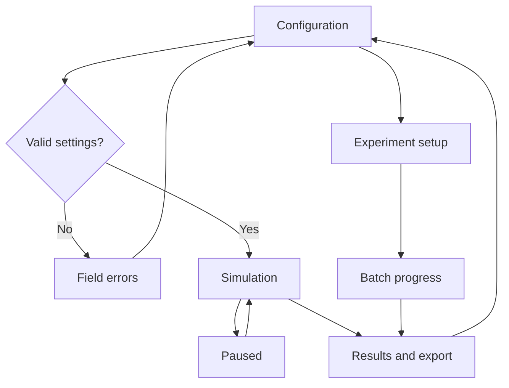
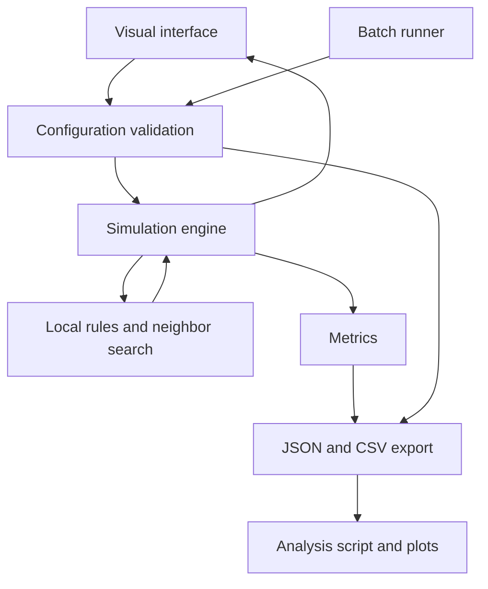

# Investigation of Emergent Behavioral Patterns in a Multi-Agent Simulation Based on Simple Rules

Author: Nevzat Kayıkçı  
Neptun: JWM27Z  
Project ID: 2026-SD-02  

[Project outline](01-project-outline.md) · [Repository](https://github.com/nevzatkay/project-work)

This specification defines a proposed local application for investigating emergent behavior in a two-dimensional multi-agent simulation. It follows the project outline. The initial model uses separation, alignment and cohesion, with optional directional noise. Model details and the experiment plan remain subject to the assigned project brief and supervisor feedback. This document describes planned behavior, not completed implementation.

## 1. Actors and permissions

| Role | Needs | Responsibility / access |
| --- | --- | --- |
| Researcher / user | Explore how local rules affect collective behavior | Configures settings, controls runs, defines experiments and exports results |
| Evaluator / supervisor | Review methods and assess whether conclusions follow from the evidence | Inspects configurations, recorded metrics, comparisons and documented limitations |
| Simulated agent | Update its position and velocity using local rules | Uses its own state and neighbors inside the interaction radius; cannot modify experiment settings or direct other agents |

The application is a local, single-user research tool. These roles describe responsibilities, not authenticated account types. A simulated agent is a model entity, not a human user or a language-model agent. Global metrics are calculated for analysis and are not fed back into agent decisions.

## 2. Use cases / user stories

### UC1: Configure and initialize a simulation
- **Actor:** Researcher / user.
- **Precondition:** The application is open and no run is active.
- **Main flow:**
  1. The user selects population, world dimensions, rule weights, interaction radius, noise, speed and acceleration limits, timestep, run duration and seed.
  2. The system validates the configuration and identifies invalid fields.
  3. The user initializes the simulation.
  4. The system creates seeded initial positions and velocities and displays the state at step zero.
- **Alternative / error flows:** Invalid input prevents initialization. If no seed is supplied, the system generates and records one before creating the state.
- **Postcondition:** A valid configuration and reproducible initial state are ready.

### UC2: Run and observe agent behavior
- **Actor:** Researcher / user.
- **Precondition:** A simulation has been initialized.
- **Main flow:**
  1. The user starts the run.
  2. Agents update synchronously using the configured local rules.
  3. The interface displays positions, movement directions, simulation time and sampled metrics.
  4. The system stops when the configured duration is reached.
- **Alternative / error flows:** Rendering may skip frames if necessary while simulation steps remain fixed. A non-finite state stops the run and marks it failed with a diagnostic.
- **Postcondition:** A completed or explicitly failed run has a recorded status and measurements.

### UC3: Pause, resume and reset
- **Actor:** Researcher / user.
- **Precondition:** A run is initialized, running or paused.
- **Main flow:**
  1. The user pauses the run.
  2. The system stops state updates and metric sampling.
  3. The user resumes from the same state or resets the run.
  4. Reset recreates the seeded initial state and clears the current run's in-memory measurements.
- **Alternative / error flows:** Resetting a run with unsaved measurements requires a discard confirmation. Changing model parameters requires a new initialization; settings cannot silently change a recorded run.
- **Postcondition:** The run continues from its paused state or returns to step zero.

### UC4: Compare rule combinations
- **Actor:** Researcher / user.
- **Precondition:** A baseline configuration and seed set have been defined.
- **Main flow:**
  1. The user selects the baseline with all three rules enabled.
  2. The system creates three additional conditions, each with one rule weight set to zero.
  3. All conditions use the same other settings, seeds, duration and sampling schedule.
  4. The system runs each condition and records its outputs separately.
  5. The user inspects metric differences and variability across seeds.
- **Alternative / error flows:** A failed run remains marked as failed and is excluded from valid-result summaries; its condition and seed remain visible.
- **Postcondition:** The contribution of each rule can be investigated using comparable records.

### UC5: Run a parameter sweep
- **Actor:** Researcher / user.
- **Precondition:** A valid baseline and selected parameter values are available.
- **Main flow:**
  1. The user chooses values for one parameter, such as noise, interaction radius or population.
  2. The user specifies seeds, duration and sampling interval.
  3. The system shows the number of planned runs and validates every condition.
  4. The system executes the batch without rendering and records progress and outcomes.
  5. The user inspects per-run metrics and condition summaries.
- **Alternative / error flows:** Invalid ranges prevent batch execution. Cancellation preserves completed outputs and marks interrupted or unstarted runs appropriately.
- **Postcondition:** Each completed condition has traceable results suitable for comparison.

### UC6: Export and reproduce a run
- **Actor:** Researcher / user.
- **Precondition:** A run has recorded data.
- **Main flow:**
  1. The user selects an output location and exports the run.
  2. The system saves configuration, seed, metric definitions, software version and status as JSON, and sampled measurements as CSV.
  3. The user loads the configuration in the same software environment.
  4. The system reinitializes and repeats the run.
  5. The user compares the repeated measurements within the documented tolerance.
- **Alternative / error flows:** Export errors retain in-memory data and show a clear message. Existing output is not overwritten without confirmation. Incomplete or failed runs are labeled.
- **Postcondition:** The run has a reproducible record, or the export failure is visible without claiming success.

## 3. Functional requirements

| ID | Requirement | Acceptance criteria | Priority |
| --- | --- | --- | --- |
| FR1 | Validate and initialize configurations | Given valid settings, when initialization is requested, then the requested population is created at step zero; invalid settings identify the offending fields and create no run | Must |
| FR2 | Use seeded random initialization | Given the same configuration and seed in the same environment, when initialized twice, then initial states match within the documented tolerance; generated seeds are recorded | Must |
| FR3 | Implement configurable local rules | Given a small controlled state, when a step runs, then steering uses only neighbors within the radius and excludes the agent itself; a zero-weight rule contributes nothing | Must |
| FR4 | Apply synchronous updates and periodic geometry | Given agents near opposite edges, when neighbors and movement are calculated, then wrapped distances are used and all agents read the same previous-step state | Must |
| FR5 | Enforce numerical limits | Given a valid run, when a step completes, then positions remain within world bounds and speed and acceleration remain within configured limits, allowing declared tolerance | Must |
| FR6 | Provide simulation controls | Given a running simulation, when paused, then steps and sampling stop; resume preserves the state and reset recreates the seeded initial state after any required discard confirmation | Must |
| FR7 | Display the simulation and metrics | Given a visual run, when it advances, then the interface shows positions, directions, step/time and the latest sampled metrics | Must |
| FR8 | Record quantitative measurements | Given a run and sampling schedule, when sampling occurs, then polarization, cluster count, largest-cluster fraction and mean nearest-neighbor distance are recorded with step/time | Must |
| FR9 | Execute rule ablations and parameter sweeps | Given validated conditions and seeds, when a batch runs, then each condition/seed receives a separate run ID, configuration, measurements and status | Must |
| FR10 | Export and load configurations and data | Given recorded data, when export succeeds, then matching JSON and CSV identify the run and its settings; loading valid JSON recreates an initialized run | Must |
| FR11 | Handle failures and cancellation | Given a failed or cancelled batch run, when progress is shown, then completed, failed, cancelled and unstarted outcomes remain distinguishable and failures are not counted as valid results | Must |
| FR12 | Summarize comparisons | Given completed runs, when analysis is requested, then summary tables/plots show the number of valid runs and variability for each condition | Should |
| FR13 | Export an animation | Given a recorded visual run, when animation export is requested, then an animation can be saved without changing scientific measurements | Could |

Priority: **Must** = required for the proposed MVP; **Should** = important; **Could** = optional if time permits.

The proposed Semester-2 MVP covers FR1–FR11. Analysis can initially use exported data and a documented script; integrated plots are FR12. Animation is outside the MVP.

## 4. Business rules and constraints

| Rule or constraint | Rationale |
| --- | --- |
| Agents share the same rule definitions and receive no centralized movement commands | Collective behavior must arise from local interactions |
| Neighborhoods exclude self and use periodic distances | Prevents self-interaction and inconsistent behavior at boundaries |
| Agents read a previous-step snapshot before any new state is applied | Avoids agent iteration-order effects |
| Rule weights and other model settings remain fixed during each recorded run | Makes configuration records meaningful |
| Time advances by a fixed simulation timestep, independent of rendering | Keeps results comparable across display speeds |
| Random initialization and noise use recorded seeded generators | Supports reproducibility |
| No-neighbor cases produce zero alignment and cohesion steering | Prevents undefined averages |
| Coincident agents and zero velocities have explicit numerical handling | Prevents division by zero and invalid states |
| Rule comparisons hold all non-tested settings fixed | Separates rule effects from unrelated changes |
| Population sweeps keep world size fixed unless a different density protocol is explicitly declared | Makes density comparisons interpretable |
| Cluster threshold is independent of interaction radius and fixed across compared conditions | Avoids changing the measurement definition while changing the model |
| Initialization transients and the analysis window are declared before the main comparison | Avoids selecting only favorable parts of a run |
| Failed and incomplete runs remain labeled and traceable | Prevents biased or misleading summaries |
| Visual observations alone do not establish a pattern or a real-world causal claim | Conclusions require metrics, repeated runs and explicit limitations |

### Initial model and measurement definitions
Agents have two-dimensional positions and velocities. Separation steers away from neighbors, alignment adjusts movement toward neighboring velocities, and cohesion steers toward the local group using wrapped displacement vectors. Weighted steering plus optional noise is acceleration-limited; velocity is updated and speed-limited before position advances and wraps at world boundaries. Exact formulas, rule normalization and noise distribution will be fixed and documented before the main experiments.

| Metric | Definition / interpretation |
| --- | --- |
| Polarization | Magnitude of the mean unit velocity vector, between 0 and 1; stationary agents contribute zero. Indicates directional agreement |
| Cluster count | Number of connected components, including isolated agents, in a periodic-distance proximity graph with a declared fixed threshold |
| Largest-cluster fraction | Number of agents in the largest proximity component divided by total population |
| Mean nearest-neighbor distance | Average distance to each agent's closest other agent, using periodic geometry; missing for a one-agent run |

A large cluster alone does not establish coordinated flocking. Patterns are interpreted using multiple measurements and visualization. Variability is calculated across runs/seeds, not by treating dependent timesteps as independent experiments.

### Input validation
Population is a positive integer; world dimensions, timestep, duration and speed/acceleration limits are positive finite values. Rule weights and noise magnitude are nonnegative finite values; interaction and cluster radii are positive. Seeds are integers in the supported range. Sampling intervals and total duration are represented as positive integer step counts derived consistently from the timestep. A single-agent run is allowed for verification, with its undefined spacing metric explicitly marked.

## 5. User interface and workflow

The application has a local visual interface for individual runs and a batch entry point for repeated experiments.

| Screen / planning wireframe | Main area | Controls and feedback |
| --- | --- | --- |
| Configuration | Fields grouped as World, Rules and Run settings | Initialize; input errors beside fields; displayed seed |
| Simulation | Agent canvas with a metrics strip showing step/time, polarization and cluster statistics | Start; Pause/Resume; Reset; Export; return to Configuration |
| Experiment setup | Baseline settings, rule-ablation options or sweep values, seed list and total run count | Validate; Run batch; range-error messages |
| Batch progress | Current condition/seed, completed/total runs and failure list | Cancel; retain completed outputs |
| Results | Run table with condition, seed and status; selected run's metric time series | Export; load configuration; comparison summaries through the analysis script |

These wireframes describe the planned layout and navigation; they are not completed application screens.

Typical workflow: configure and initialize (UC1), observe and control (UC2–UC3), compare rules or sweep a parameter (UC4–UC5), then export and reproduce results (UC6).

## 6. Non-functional requirements

Numeric performance targets are provisional and will be refined after profiling on the documented test laptop.

| Requirement | How it will be verified |
| --- | --- |
| Seeded runs are reproducible in the same environment | Repeat a configuration and compare states/metrics using declared absolute and relative tolerances |
| Interactive control remains responsive | Initial target: 200 agents at at least 20 displayed frames per second; record hardware, update cost and frame rate in a pilot |
| Rendering does not affect simulated outcomes | Compare visual and headless runs with identical settings and seeds |
| Numerical edge cases are handled reliably | Check no neighbors, zero velocity, coincident agents, single-agent runs and edge crossings |
| Results are traceable and portable | Inspect exported JSON/CSV for configuration, seed, units, definitions, version and status; open them using standard tools |
| Installation is documented and repeatable | Verify a clean installation using the recorded Python version and pinned dependency versions |
| Components can be maintained independently | Keep simulation, rules, metrics, visualization, export and experiment execution separate |
| Inputs and operational failures are understandable | Exercise invalid configurations, unwritable export locations and cancelled/failed runs and inspect the feedback |

## 7. Open questions and risks

| Question / risk | Impact | Owner | Resolution / decision |
| --- | --- | --- | --- |
| Does the proposed flocking model match the full assigned brief? | Scope could require changes | Nevzat Kayıkçı | Confirm the model and MVP with the supervisor before implementation |
| Which formulas, normalization and noise distribution should be used? | Changes observed behavior and comparability | Nevzat Kayıkçı | Document the chosen definitions and verify small controlled states |
| Which parameter ranges, seeds and analysis window are feasible? | Experiments may be too large or inconclusive | Nevzat Kayıkçı | Run pilots, then freeze the main protocol and repetition count |
| Pairwise neighbor search may be slow | Limits population and batch throughput | Nevzat Kayıkçı | Profile first; introduce spatial indexing only if necessary |
| Cluster threshold may dominate apparent grouping | Weakens conclusions | Nevzat Kayıkçı | Keep it fixed across conditions and perform a sensitivity check |
| Patterns may depend strongly on initial conditions | Single runs can mislead | Nevzat Kayıkçı | Compare repeated runs with a shared recorded seed set |
| Many simultaneous parameter changes may confound effects | Difficult interpretation | Nevzat Kayıkçı | Start with single-rule ablations and one-parameter sweeps |
| Floating-point differences across environments | Exact cross-platform reproduction may fail | Nevzat Kayıkçı | Record versions and tolerances; avoid promising bitwise cross-platform identity |
| Supervisor and presentation feedback are not yet recorded | Decisions may remain unresolved | Nevzat Kayıkçı | Record dated feedback and adopted/deferred actions after consultations and presentations |

## 8. Initial technical proposal

### Proposed solution and technology direction
A local Python application will share one simulation engine between interactive and batch execution. NumPy is proposed for state arrays and calculations, Pygame for the agent canvas and basic controls, and Matplotlib for offline analysis plots. JSON will store configurations/metadata and CSV will store sampled measurements. These are proposed choices to validate in the first prototype.

### Architecture sketch

Configuration validation produces a run description. The engine initializes state and seeded randomness, evaluates local rules from a common snapshot and advances fixed steps. Metrics read sampled states without changing agent behavior. Export combines configuration, status and time-series records. The analysis script compares completed runs and reports excluded failures.

### Data records

| Record | Main fields |
| --- | --- |
| Configuration / JSON | Schema version, world dimensions, population, rule weights, radii, noise settings, limits, timestep, total steps, sampling interval and seed |
| Run metadata / JSON | Run ID, condition ID, software version, numerical tolerance, metric definitions, status and failure/cancellation details |
| Measurement / CSV | Run ID, step, simulation time, polarization, cluster count, largest-cluster fraction and mean nearest-neighbor distance |
| Experiment plan / JSON | Baseline, condition changes, seed set, comparison settings and analysis window |

### Feasibility, trade-offs and validation
- Start with direct pairwise neighbor calculations because they are easy to inspect; their quadratic cost will be measured before adding a spatial grid.
- Separate simulation time from wall-clock time and rendering, so display delays do not change the experiment.
- Validate geometry, rules and metrics on small states before interpreting large runs.
- Check seeded repeats, visual/headless equivalence, export/load behavior and requirement acceptance criteria.
- Validate the interface and performance target early; adjust supported population limits with evidence.

## 9. Semester-2 implementation plan

| Stage | Work | Exit evidence |
| --- | --- | --- |
| 1 | Confirm assigned brief, MVP and model definitions | Recorded supervisor decisions and updated outline/specification |
| 2 | Implement seeded initialization, periodic geometry and synchronous rules | Small-state checks and reproducibility results |
| 3 | Add visualization, controls and metrics | Demonstration of UC1–UC3 |
| 4 | Add experiment batches, export/load and status handling | Reproducible records for UC4–UC6 |
| 5 | Profile and run pilots | Feasible ranges, repetition count and frozen experiment plan |
| 6 | Execute agreed comparisons and prepare documentation | Traceable results, limitations and inputs for Semester-3 thesis work |

Dates follow the announced course schedule. Consultation and presentation feedback will be recorded with the author's decisions; discussants provide recommendations and do not approve or own the project.

