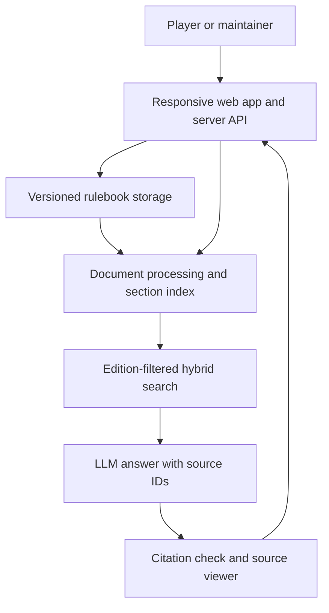

> Second mandatory semester-1 presentation: specification, initial technical proposal, and Semester-2 plan.

<!-- 5xl -->
# Board-game rules companion with source references

A mobile-friendly assistant for situational rules questions

Author: Nevzat Kayıkçı  
Neptun: JWM27Z  
Supervisor: Sári Dávid  
Project ID: 2026-SD-02

## Specification summary

**Goal:** Help players answer situation-specific questions from the selected game rules, with links to the evidence.

**First version**
- A few selected games and permitted PDF or Markdown rulebooks
- Edition and expansion selection
- Cited answers, clarification, and clear unresolved responses
- Saved questions, notes, and error reports

The app explains rules. It does not run or judge the game.

---

## Main user journeys and requirements

**Prepare:** Upload a permitted rulebook and identify its game, edition, and expansions.  
**Ask:** Select that rules collection and describe a situation. The app retrieves only applicable rules and asks for missing details.  
**Check:** Read the answer, open its source, save the question, or report an error.

**Acceptance checks**
- Citations open the exact source version.
- Search stays within the selected rules.
- Saved questions and notes survive a reload.
- Missing or conflicting evidence does not become a confident ruling.

---

## Initial technical proposal

### Proposed system flow

- Separate the app, storage, document processing, search, and AI parts.
- Preserve document versions and exact source locations.
- Combine keyword and semantic search, then follow applicable cross-references.
- Send retrieved excerpts to the model and check citations before display.
- Keep credentials server-side; AI failure must not erase saved work.

**To be decided:** framework, database, file storage, search tools, model, and hosting. Compare feasibility, cost, security, and reproducibility first.

---

## Semester-2 implementation plan

1. **Select sources:** confirm usage conditions, games, data model, and test questions.
2. **Process documents:** import files, preserve versions, map sections, and verify citations.
3. **Build the question flow:** filter by edition, retrieve rules, clarify, answer, and open sources.
4. **Evaluate:** add history and failure handling; compare both approaches on the same checked dataset.

**Deliverables:** working MVP, documented design, reproducible tests, and measured results. No results are assumed in advance.

---

## Open risks and next steps

**Risks:** rulebook permissions, PDF extraction errors, edition mix-ups, unsupported AI answers, and limited time.

**Next:** confirm usable sources, test the design with a small prototype, set evaluation targets after a pilot, and review the plan with the supervisor.

**Success:** players can check the rule behind an answer, and the app clearly says when it cannot establish one.
