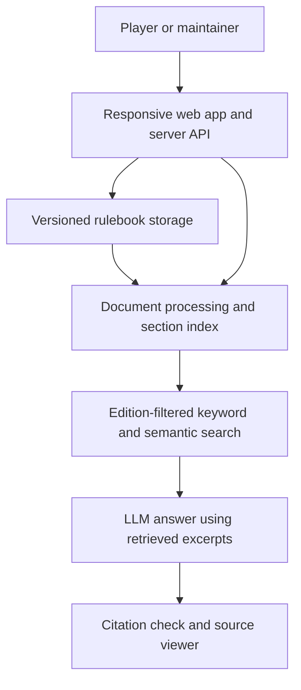

<!-- 5xl -->
# Board-game rules companion with source references

Second presentation: specification, technical proposal, and Semester-2 plan

Author: Nevzat Kayıkçı  
Neptun: JWM27Z  
Supervisor: Sári Dávid  
Project ID: 2026-SD-02

---

## Specification summary

**Goal:** Help players answer situation-based questions using the correct game rules and show the source for each answer.

**First version**
- A few selected games with permitted PDF or Markdown rulebooks
- Game, edition, and expansion selection
- Answers with rulebook references
- Follow-up questions or a clear “cannot answer”
- Saved questions, notes, and error reports

**Out of scope:** running the game, enforcing moves, or acting as an opponent.

---

## Main user journeys and requirements

**Prepare:** Upload a permitted rulebook and identify its game and edition.

**Ask:** Select that rules collection and describe the situation. The app searches only those rules and asks for missing details.

**Check:** Read the answer, open its source, save the question, or report an error.

**Acceptance checks**
- A citation opens the exact rulebook version and location.
- Saved questions and notes remain after reload.
- Missing or conflicting evidence does not produce a confident answer.

---

## Initial technical proposal

### Proposed system flow

- Keep the app, storage, processing, search, and AI parts separate.
- Preserve document versions and source locations.
- Check citations before showing an answer.
- Keep credentials on the server and saved work during AI failures.

**Still to choose:** framework, database, search tools, AI model, and hosting. Compare cost, security, and feasibility before deciding.

---

## Semester-2 implementation plan

1. **Choose sources:** confirm permitted rulebooks, games, and test questions.
2. **Build document processing:** import files, preserve versions, map sections, and verify references.
3. **Build the question flow:** select edition, find rules, ask for missing details, and show a cited answer.
4. **Test and improve:** add saved history and failure handling, then compare both approaches with the same checked questions.

**Deliverables:** a working first version, documented design, repeatable tests, and measured results.

---

## Open risks and next steps

**Risks:** rulebook permissions, extraction or citation errors, mixing editions, unsupported AI answers, and limited time.

**Next steps:** confirm usable sources, test the design with a small prototype, set evaluation targets after a pilot, and review the plan with the supervisor.

**Success means** players can check the source behind an answer, and the app is clear when it cannot establish one.
